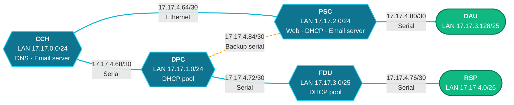
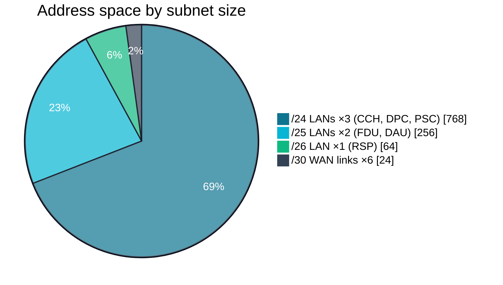
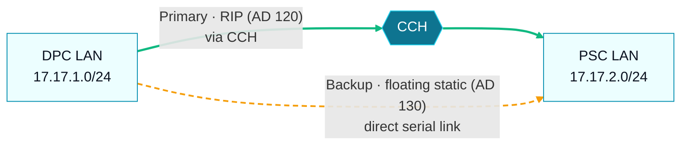
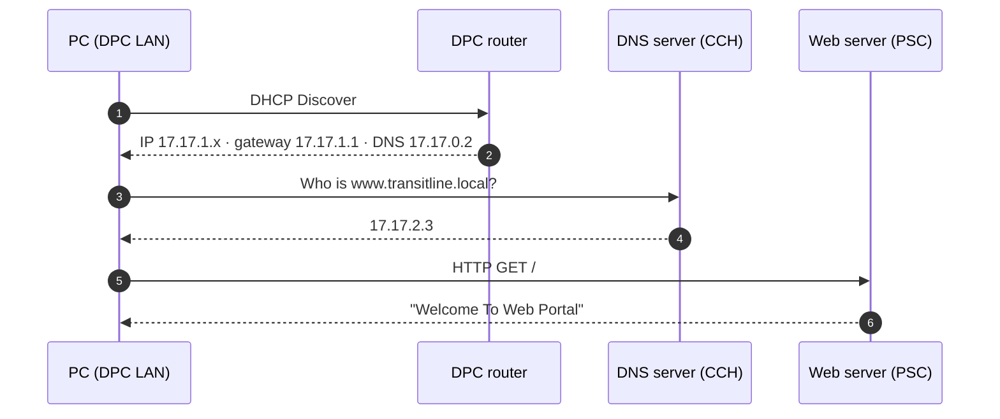

<div align="center">


<a href="https://github.com/sabikswanan/Smart-Transit-Network-System"></a>

<br/>


<br/><br/>

**[Overview](#overview)** &nbsp;|&nbsp;
**[Topology](#topology)** &nbsp;|&nbsp;
**[Addressing](#addressing)** &nbsp;|&nbsp;
**[Routing](#routing)** &nbsp;|&nbsp;
**[Services](#services)** &nbsp;|&nbsp;
**[Getting Started](#getting-started)** &nbsp;|&nbsp;
**[Team](#team)**

</div>

<br/>

<a name="overview"></a>

## 🚇 Overview

A transit operator runs six sites that need to share data, email and a web portal reliably. This
project designs and simulates that network end to end in **Cisco Packet Tracer**: an efficient
**VLSM** addressing plan, a mix of **dynamic (RIP)** and **static routing** with a **floating static
backup path**, and the core **network services** every site depends on.

> [!NOTE]
> **Goal:** connect six transit sites so that every host can reach every other host and use shared
> DHCP, DNS, web and email services, with a backup route if the main path fails.

Built as a **Group 308** project for **CSE421 — Computer Networks** at **BRAC University**.

<br/>

<a name="topology"></a>

## 🗺️ Topology



<sub>**Teal** sites run RIP · **green** sites are static-only stubs · the dashed amber DPC–PSC link is the floating static backup path. Every site LAN also has 2 PCs and a printer behind a Cisco 2960 switch.</sub>

<details>
<summary><b>Device inventory</b></summary>
<br/>

| Device | Model | Count |
|---|---|:---:|
| Router | Cisco 1841 | 6 |
| Switch | Cisco 2960-24TT | 7 |
| PC | PC-PT | 12 |
| Printer | Printer-PT | 6 |
| Server | Server-PT | 5 |
| Links | Copper Ethernet and serial | 36 |

</details>

<br/>

<a name="addressing"></a>

## 🧮 Addressing — VLSM

The whole design fits inside **17.17.0.0 – 17.17.4.87**. Subnets were allocated largest-first, so
each site gets exactly the block it needs and the six point-to-point links use tight **/30** subnets.



<table>
<tr>
<td valign="top">

**LAN subnets**

| Site | Subnet | Gateway | Hosts get IPs via |
|---|---|---|---|
| CCH | `17.17.0.0/24` | `.1` | Static |
| DPC | `17.17.1.0/24` | `.1` | Router DHCP pool |
| PSC | `17.17.2.0/24` | `.1` | DHCP server |
| FDU | `17.17.3.0/25` | `.1` | Router DHCP pool |
| DAU | `17.17.3.128/25` | `.129` | Static |
| RSP | `17.17.4.0/26` | `.1` | Static |

</td>
<td valign="top">

**Point-to-point links**

| Link | Subnet | Type |
|---|---|---|
| CCH ↔ PSC | `17.17.4.64/30` | Ethernet |
| CCH ↔ DPC | `17.17.4.68/30` | Serial |
| DPC ↔ FDU | `17.17.4.72/30` | Serial |
| FDU ↔ RSP | `17.17.4.76/30` | Serial |
| PSC ↔ DAU | `17.17.4.80/30` | Serial |
| DPC ↔ PSC | `17.17.4.84/30` | Serial (backup) |

</td>
</tr>
</table>

<br/>

<a name="routing"></a>

## 🔀 Routing

The network combines **RIP** in the core with **static routes** at the edges, then redistributes
the static routes into RIP so every router learns every subnet.

| Router | Role | Dynamic | Static configuration |
|---|---|:---:|---|
| **CCH** | Core hub | RIP | Routes to FDU, DAU and RSP LANs · **redistributes static into RIP** |
| **PSC** | Core · services site | RIP | Routes to DAU and RSP LANs · floating static to DPC LAN |
| **DPC** | Core | RIP | Route to RSP LAN · floating static to PSC LAN |
| **FDU** | Core | RIP | Route to RSP LAN |
| **DAU** | Stub site | — | 5 static routes via PSC |
| **RSP** | Stub site | — | Default route + static route via FDU |

### Failover with floating static routes



> [!TIP]
> RIP runs as **passive** on the direct DPC–PSC link, so traffic normally flows through CCH. The
> floating static routes on that link carry an **administrative distance of 130** — higher than
> RIP's 120 — so they only take over if the RIP path disappears.

<details>
<summary><b>Example: static routes on the DAU stub router</b></summary>
<br/>

```text
ip route 17.17.0.0   255.255.255.0   17.17.4.81
ip route 17.17.1.0   255.255.255.0   17.17.4.81
ip route 17.17.2.0   255.255.255.0   17.17.4.81
ip route 17.17.3.0   255.255.255.128 17.17.4.81
ip route 17.17.4.0   255.255.255.192 17.17.4.81
```

</details>

<details>
<summary><b>Example: RIP with redistribution on CCH</b></summary>
<br/>

```text
router rip
 redistribute static metric 1
 network 17.0.0.0
```

</details>

<br/>

<a name="services"></a>

## 🛰️ Services

| Service | Host | Address | Details |
|---|---|---|---|
| **DNS** | DNS-CCH | `17.17.0.2` | A records for `cch.transitline.com`, `transitline.com` and `www.transitline.local` |
| **Web (HTTP)** | PSC-WEB | `17.17.2.3` | Transit web portal, reachable as `www.transitline.local` |
| **Email (SMTP/POP3)** | Email-CCH | `17.17.0.3` | Mail domain `cch.transitline.com` |
| **Email (SMTP/POP3)** | PSC-Email | `17.17.2.4` | Mail domain `transitline.com` with mailboxes for DAU, RSP, FDU, DPC and PSC |
| **DHCP** | PSC-DHCP | `17.17.2.2` | Pool for the PSC LAN, hands out gateway and DNS server |
| **DHCP** | DPC and FDU routers | — | Router-based pools with the first 10 addresses reserved |

### What happens when a PC at DPC opens the web portal



<br/>

<a name="getting-started"></a>

## 🚀 Getting Started

1. Install [Cisco Packet Tracer](https://www.netacad.com/courses/packet-tracer) (**8.2** or newer).
2. Clone or download this repository.
3. Open `CSE421_project.pkt`.

```bash
git clone https://github.com/sabikswanan/Smart-Transit-Network-System.git
```

<details>
<summary><b>Things to try once it is open</b></summary>
<br/>

| Try this | Where | What it checks |
|---|---|---|
| `show ip route` | Any router → CLI | Connected, RIP (`R`) and static (`S`) routes in the table |
| `ipconfig` | A DPC, FDU or PSC PC → Command Prompt | The address handed out by DHCP |
| `ping 17.17.4.2` | Any PC → Command Prompt | End-to-end reachability to a PC in the RSP LAN |
| Open `www.transitline.local` | Any PC → Web Browser | DNS resolution and the HTTP web portal |
| Send an email | A PC → Email client | The SMTP/POP3 mail servers |
| Simulation mode | Bottom-right toggle | Watch packets travel hop by hop |

</details>

<br/>

<a name="team"></a>

## 👥 Team — Group 308

| Student ID | Responsibility |
|---|---|
| 24101007 | VLSM tree and special conditions |
| 24101234 | Dynamic routing |
| 24101656 | Static routing requirements and topology drawing |
| 23241049 | Services and router configuration |

<br/>

<div align="center">

**Sabik Swanan**<br/>
B.Sc. in Computer Science · BRAC University

<br/>

<a href="https://github.com/sabikswanan"></a>
<a href="https://www.linkedin.com/in/sabikswanan"></a>
<a href="https://mail.google.com/mail/?view=cm&fs=1&to=sabikswanan@gmail.com"></a>

<br/><br/>

<sub>⭐ Star this repo if you found it useful</sub>


</div>
